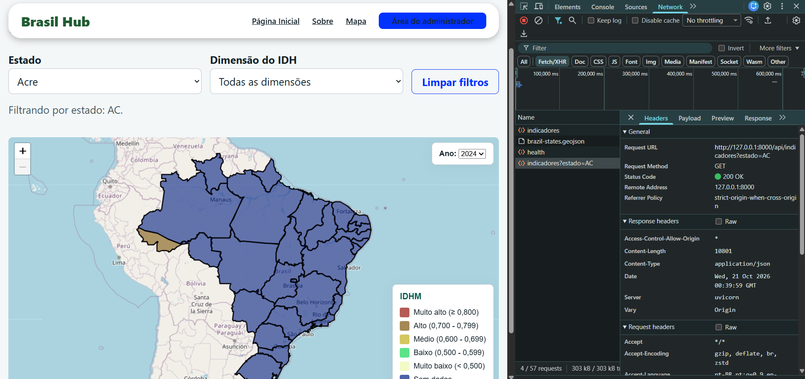
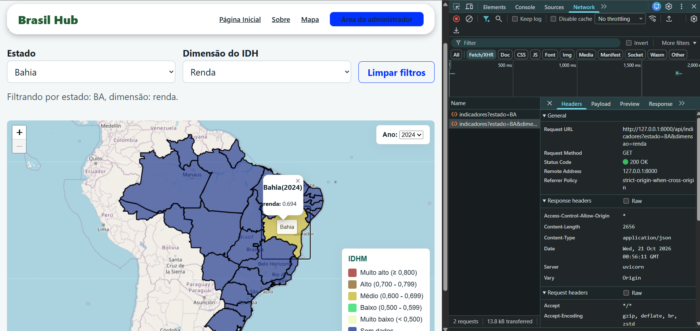
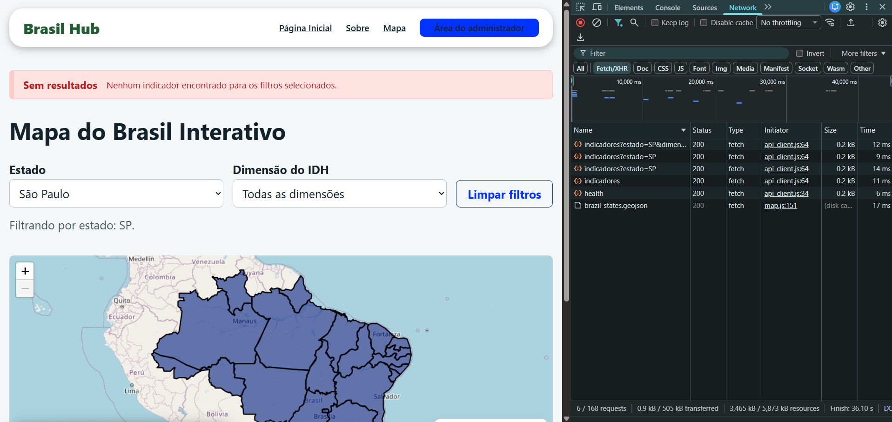
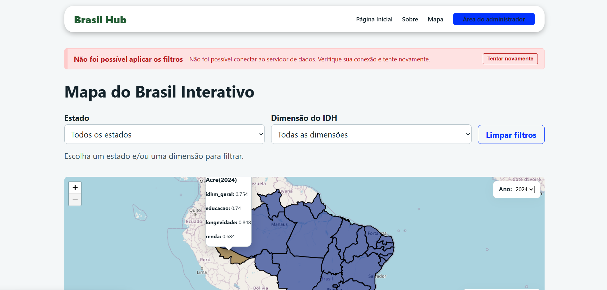

# Testes e Garantia de Qualidade

Foi estruturada uma estratégia contínua de testes que acompanhou cada entrega desde as primeiras Sprints.

Esta página consolida o que testamos até o encerramento da **Sprint 7 (Release 1)**, como executamos cada nível de verificação, o mapeamento completo dos casos de teste (**TC-01 a TC-12**) definidos no [Documento de Visão](../documentos/visao/testes.md) e as evidências registradas.

## Resumo da Suíte Automatizada (Ciclo 1 — Homologação)

A verificação e validação do **Brasil Hub** totalizam **142 testes automatizados** executados continuamente via GitHub Actions e homologados na versão de produção:

- **Back-end e API (Pytest — 108 testes):** Testes unitários e de integração cobrindo ingestão/higienização de CSV com Pandas, regras de negócio, repositório PostgreSQL/SQLite, contratos REST, hash `bcrypt` e tempo de resposta (`B-05`).
- **Front-end e Sistema E2E (Playwright — 34 testes):** Testes ponta a ponta em navegador real distribuídos em 6 arquivos de especificação:
  - `tests/e2e/acessibilidade.spec.js`
  - `tests/e2e/area-adm.spec.js`
  - `tests/e2e/erros.spec.js`
  - `tests/e2e/index.spec.js`
  - `tests/e2e/mapa.spec.js`
  - `tests/e2e/valores-oficiais.spec.js`
  
---

## 1. Arquitetura de Testes na Prática

Ao longo das entregas, dividimos nossa verificação de qualidade em três camadas complementares:

```
[ Testes Unitários ]       -> Validam regras isoladas (tratamento Pandas, ordenação e cálculos no Service)
        ↓
[ Testes de Integração ]   -> Validam contratos HTTP entre a API (FastAPI) e a camada de Persistência (SQLite)
        ↓
[ Testes de Sistema ]      -> Validam a aplicação integrada pela interface web (Mapa, Filtros, Acessibilidade)
```

### Automação e Integração Contínua (CI)

No back-end, construímos uma suíte com **mais de 100 testes automatizados utilizando Pytest**, integrada ao **GitHub Actions**:

- A cada Pull Request aberto para a `developer` ou para a `main`, o pipeline de CI inicializa o ambiente isolado, instala as dependências e executa toda a suíte automatizada.
- Qualquer falha em teste unitário ou de integração bloqueia o merge, protegendo a branch principal contra regressões.

---

## 2. Escopo Coberto pela Suíte Automatizada

1. **Tratamento de Dados e Regras de Negócio (`tests/data/test_processamento_csv.py`):**
   - Padronização de siglas de UF, códigos IBGE (11 a 53) e validação das 4 dimensões (`idhm_geral`, `renda`, `educacao`, `longevidade`).
   - Preservação de valores ausentes como `None`/`null` (**RN-02**), garantindo que períodos sem medição jamais sejam convertidos em zero.
   - Rejeição controlada de arquivos vazios, corrompidos, com colunas ausentes ou codificação inválida.

2. **Segurança e Autenticação Administrativa (`tests/test_auth_service.py`):**
   - Verificação de senhas com hash `bcrypt` e salt dinâmico (**B-09 / TC-08**).
   - Garantia de que a senha em texto puro nunca é persistida e o `password_hash` nunca é exposto nas respostas da API.

3. **Consultas, Comparação e Desempenho da API (`tests/test_funcionalidade_api.py` e `tests/test_indicador_service.py`):**
   - Validação dos filtros combinados de estado, dimensão e período (**B-02 / TC-01 e TC-02**).
   - Verificação automatizada do requisito de desempenho **B-05 (TC-06)**: tempo de resposta inferior a 3 segundos medido com `time.perf_counter()`.
   - Regras de comparação entre duas UFs (**B-06 / TC-09**) e estruturação determinística para gráficos e tabelas (**B-10 / TC-10**).

4. **Upload Protegido e Transacionalidade (`tests/test_upload_indicadores.py`):**
   - Bloqueio de uploads sem credenciais válidas (`HTTP 401`) e garantia de atomicidade (**RN-05**): se uma linha do CSV for inválida, nenhuma alteração parcial é gravada no banco.

---

## 3. Matriz de Rastreabilidade e Resultados dos Casos de Teste (TC-01 a TC-12)

A tabela abaixo correlaciona cada caso de teste do Documento de Visão com sua situação atual, funções de teste automatizadas e evidências:

| Caso | Requisito | Nível | Como foi testado | Teste(s) responsável(is) / Evidência | Arquivo | Situação |
| :--- | :---: | :---: | :--- | :--- | :--- | :---: |
| **TC-01** (Filtrar dados) | B-02 | Unitário | Automatizado | `test_filtros_sao_enviados_como_parametros()`<br>`test_consultar_repassa_filtros_ao_repositorio()`<br>`test_b05_filtros_validos()` | `tests/test_indicador_repository.py`<br>`tests/test_indicador_service.py` | **Aprovado ✅** |
| **TC-02** (API de filtros) | B-02 | Integração | Automatizado | `test_sucesso_busca_indicadores_via_http()`<br>`test_validacao_estado_vazio()`<br>`test_validacao_dimensao_invalida_ou_vazia()`<br>`test_validacao_periodo_limites_e_tipos_invalidos()` | `tests/test_funcionalidade_api.py` | **Aprovado ✅** |
| **TC-03** (Exibição no mapa) | B-01 | Sistema | Manual (Interface) | Pintura coroplética das 27 UFs por faixa de IDHM e abertura de detalhes da UF selecionada. Evidências visuais na Seção 4 (`TI-01` a `TI-04`). | `src/frontend/mapa.html`<br>`src/frontend/js/map.js` | **Aprovado ✅** |
| **TC-04** (Acessibilidade) | B-03 | Sistema | Manual (Interface) | Controles de escala tipográfica (`A+`/`A-`), alternância de tema escuro e modo de alto contraste homologados na barra de navegação (PR #70, #71). | `src/frontend/js/theme.js`<br>`src/frontend/css/variables.css` | **Aprovado ✅** |
| **TC-05** (Upload de CSV) | B-04 | Sistema / Integração | Misto | **API:** `test_upload_sem_autenticacao_retorna_401()`, `test_upload_valido_retorna_sucesso()`, `test_linha_invalida_nao_grava_linhas_validas()`<br>**UI:** Envio via `painel-adm.html` (PR #60). | `tests/test_upload_indicadores.py`<br>`src/frontend/painel-adm.html` | **Aprovado ✅** |
| **TC-06** (Desempenho ≤ 3s) | B-05 | Integração | Automatizado | `test_b05_dados_corretos_e_desempenho()` (tempo aferido < 0,5 s via `time.perf_counter()`). | `tests/test_funcionalidade_api.py` | **Aprovado ✅** |
| **TC-07** (Dispositivos/Telas) | B-08 | Sistema | Manual (Interface) | Validação em Chrome, Firefox e Edge nas resoluções desktop (`1280x950`) e mobile (`360x800`, `414x846`, `712x1138`) na issue S6-02 (PR #63). | `src/frontend/css/style.css` | **Aprovado ✅** |
| **TC-08** (Senha com hash) | B-09 | Unitário / Integração | Automatizado | `test_autenticacao_sucesso()` (validação `bcrypt` e ocultação de hash)<br>`test_autenticacao_senha_incorreta()`<br>`test_login_com_credenciais_validas()` | `tests/test_auth_service.py`<br>`tests/test_funcionalidade_api.py` | **Aprovado ✅** |
| **TC-09** (Comparar UFs) | B-06 | Sistema / Integração | Misto | **API/Service:** `test_comparacao_com_sucesso_anos_diferentes()`, `test_integracao_comparar_estados_iguais_mesmo_ano()`, `test_comparacao_sem_anos_encontra_mais_recente_comum()`<br>**UI:** Seleção lado a lado em `comparacao.js` (PR #76). | `tests/test_indicador_service.py`<br>`tests/test_funcionalidade_api.py`<br>`src/frontend/js/comparacao.js` | **Aprovado ✅** |
| **TC-10** (Gráficos/Tabelas) | B-10 | Sistema / Integração | Misto | **API/Service:** `test_consultar_organizacao_dos_indicadores()`, `test_integracao_consulta_estrutura_tabela_e_grafico()`, `test_integracao_contrato_dados_para_tabela_e_grafico()`<br>**UI:** Sincronização entre gráfico e tabela (PR #78, #79). | `tests/test_indicador_service.py`<br>`tests/test_funcionalidade_api.py` | **Aprovado ✅** |
| **TC-11** (Linha do tempo) | B-07 | Sistema / Unitário | Em execução (S8) | Planejado na issue **S8-01** (Sprint 8 — requisito COULD). | — | **Em execução (S8) ⏳** |
| **TC-12** (Exportação CSV) | B-11 | Sistema | Em execução (S8) | Planejado na issue **S8-02** (Sprint 8 — requisito COULD). | — | **Em execução (S8) ⏳** |

---

## 4. Evidências Visuais de Execução (Testes de Integração e Sistema)

Abaixo estão registradas as evidências visuais da integração entre o Mapa Interativo (Leaflet), os Filtros Dinâmicos e a API de Indicadores (**TC-01, TC-02 e TC-03 — Issue S4-03**):

| Cenário Validado | Evidência Capturada |
| :--- | :---: |
| **TI-01 — Carregamento inicial do Mapa Interativo e pintura das 27 UFs** |  |
| **TI-02 — Filtragem dinâmica por Unidade Federativa e destaque territorial** |  |
| **TI-03 — Filtragem por Dimensão do IDHM e atualização da legenda** |  |
| **TI-04 — Tratamento visual de estado da API e resposta integrada** |  |

> **Nota para a Sprint 8 (Issue S8-04):** Os registros detalhados da bateria de homologação de sistema da Sprint 8 (`TC-03`, `TC-04`, `TC-05`, `TC-07`, `TC-09` e `TC-10`), contendo versão/commit, ambiente, dados utilizados, resultado obtido e novas capturas de tela, deverão ser anexados abaixo pelos responsáveis pela issue **S8-04**.

---

## 5. Como Executar a Suíte de Testes Localmente

1. Suba o serviço da aplicação com Docker Compose:
   ```bash
   docker compose up -d
   ```

2. Execute a suíte completa do Pytest:
   ```bash
   python -m pytest -v
   ```
