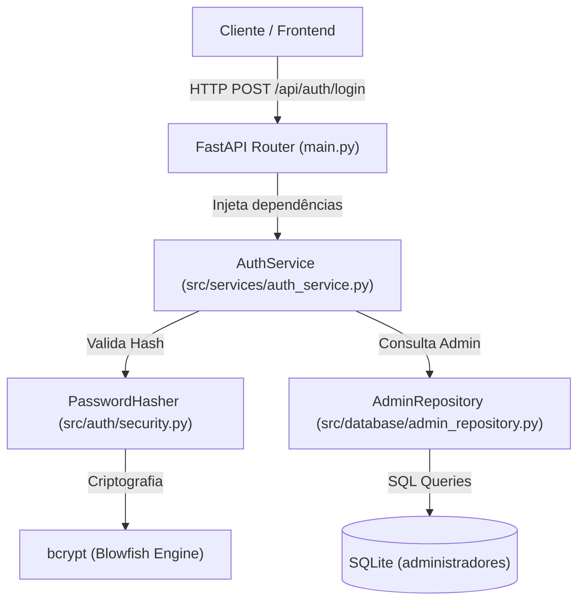

# Autenticação do Administrador (Issue B-09)
---
## 1. Visão Geral e Arquitetura

### Arquitetura em Camadas (POO)

A solução segue o **Princípio da Responsabilidade Única (SRP)** e o padrão **Repository**, garantindo que a regra de negócio da autenticação seja completamente desacoplada do mecanismo de persistência e do framework web:



---

## 2. Oq já foi feito — Parte 1 (Josef)

Já cobri a camada de domínio, criptografia, persistência e testes unitários automatizados:

### 2.1. Criptografia Segura (`PasswordHasher`)
* **Arquivo:** `src/auth/security.py`
* **Biblioteca:** `bcrypt` (adicionada ao `requirements.txt`).
* **Regras de Negócio e Segurança:**
  * Gera salt seguro com `bcrypt.gensalt()`.
  * Calcula hashes em formato string decodificada (`.decode('utf-8')`).
  * Valida senhas com `bcrypt.checkpw()`, garantindo resistência a ataques de tempo (*timing attacks*).
  * Dispara `ValueError` se a senha fornecida for nula, vazia ou composta unicamente por espaços em branco.

### 2.2. Repositório de Dados (`AdminRepository`)
* **Arquivo:** `src/database/admin_repository.py`
* **Tabela utilizada:** `administradores` (definida no schema em `src/database/database.py`).
* **Design:**
  * Atributo `_db_path` encapsulado.
  * Método `buscar_por_usuario(usuario: str)`: Consulta parametrizada (`WHERE usuario = ?`), retornando um `dict` com os campos do registro ou `None`.
  * Método `salvar(usuario: str, password_hash: str)`: Insere novo administrador e confirma a transação com `commit()`.
  * Todas as operações utilizam blocos `try ... finally: conn.close()` para evitar vazamento de conexões no SQLite.

### 2.3. Serviço de Autenticação (`AuthService`)
* **Arquivo:** `src/services/auth_service.py`
* **Exceção de Domínio:** `CredenciaisInvalidasException(Exception)`.
* **Regras de Negócio Implementadas:**
  * **Injeção de Dependência:** O construtor recebe instâncias de `repository` e `hasher`.
  * **Proteção contra Enumeração de Usuários:** Tanto usuários inexistentes quanto senhas incorretas disparam a mesma exceção com a mensagem genérica *"Credenciais inválidas."*.
  * **Sanitização de Retorno (Vazamento de Senha):** O método `autenticar` devolve apenas dados seguros (`{"id": ..., "usuario": ...}`), omitindo terminantemente o campo `password_hash`.

### 2.4. Testes Unitários Automatizados
* **Arquivo:** `tests/test_auth_service.py`
* **Status:** 100% de aprovação no `pytest`.
* **Cenários Cobertos:**
  1. `test_autenticacao_sucesso`: Valida credenciais corretas e assegura ausência da chave `password_hash` no retorno.
  2. `test_autenticacao_senha_incorreta`: Garante rejeição com `CredenciaisInvalidasException`.
  3. `test_autenticacao_usuario_inexistente`: Garante rejeição idêntica para usuários não cadastrados.

---

## 3. Para continuar — Parte 2 (Lucas)

Consiste na exposição da autenticação via HTTP, proteção de rotas restritas, script de inicialização do primeiro administrador e testes de integração.

### 3.1. Preparação do Ambiente
Sincronizar a branch de trabalho e executar a suíte de testes:
```powershell
git checkout feature/B-09-autenticacao-admin
git pull origin feature/B-09-autenticacao-admin
.venv\Scripts\Activate.ps1
pip install -r requirements.txt
pytest tests/test_auth_service.py -v
```

### 3.2. Tarefas a Executar

#### Tarefa A: Contratos Pydantic (`src/api/schemas.py`)
Criar os esquemas de validação de dados:
```python
from pydantic import BaseModel

class LoginRequest(BaseModel):
    usuario: str
    senha: str

class LoginResponse(BaseModel):
    id: int
    usuario: str
    mensagem: str = "Autenticação realizada com sucesso."
```

#### Tarefa B: Endpoint de Login (`src/api/main.py`)
Criar a função de injeção de dependência e a rota POST:
1. `get_auth_service() -> AuthService`: Instancia `AdminRepository()` e `PasswordHasher` e devolve o serviço.
2. Endpoint `@app.post("/api/auth/login", response_model=LoginResponse)`:
   * Invoca `auth_service.autenticar(requisicao.usuario, requisicao.senha)`.
   * Captura `CredenciaisInvalidasException` e lança `HTTPException(status_code=401, detail="Credenciais inválidas.")`.
   * Retorna `200 OK` em caso de sucesso.

#### Tarefa C: Mecanismo de Proteção de Rotas Administrativas
1. Definir uma dependência FastAPI (ex: `obter_admin_autenticado`) para inspecionar credenciais/tokens de autorização nas rotas administrativas.
2. Criar uma rota restrita de exemplo (ex: `GET /api/admin/painel`) demonstrando a proteção com `Depends()`.

#### Tarefa D: Script de Seed do Administrador Inicial (`scripts/seed_admin.py`)
Criar um script CLI para configurar a conta administrativa inicial sem expor senhas no repositório:
* Lê as variáveis `ADMIN_USER` e `ADMIN_PASSWORD` do arquivo `.env`.
* Gera o hash da senha através do `PasswordHasher.gerar_hash(...)`.
* Persiste o administrador via `AdminRepository().salvar(...)`.
* Documentar a instrução de execução no `.env.example` e no `README.md`.

#### Tarefa E: Testes Automatizados de Integração (`tests/test_funcionalidade_api.py`)
Criar testes usando o `TestClient`:
* `test_login_com_credenciais_validas`: Requisição POST com dados válidos retorna `200` e dados seguros.
* `test_login_com_credenciais_invalidas`: Requisição POST com senha errada ou usuário incorreto retorna `401`.
* `test_rota_protegida_sem_autenticacao`: Acesso à rota administrativa sem autenticação retorna `401`.

---

## 4. Matriz de Rastreabilidade e Critérios de Aceitação

| Critério de Aceitação da Issue | Responsável | Status |
|---|---|---|
| As senhas são armazenadas com hash, e não em texto simples | Josef | Concluído |
| Verificação da senha com biblioteca apropriada (`bcrypt`) | Josef | Concluído |
| Senhas não retornadas pela API nem registradas em logs | Josef | Concluído |
| Credenciais válidas e inválidas tratadas na regra de negócio | Josef | Concluído |
| Testes unitários para autenticação válida e inválida | Josef | Concluído |
| Existe um endpoint para autenticação do administrador | Lucas | Pendente |
| As rotas administrativas verificam a autenticação no back-end | Lucas | Pendente |
| Existe uma forma documentada de configurar conta inicial (seed) | Lucas | Pendente |
| Testes automatizados de integração HTTP (200 / 401) | Lucas | Pendente |
