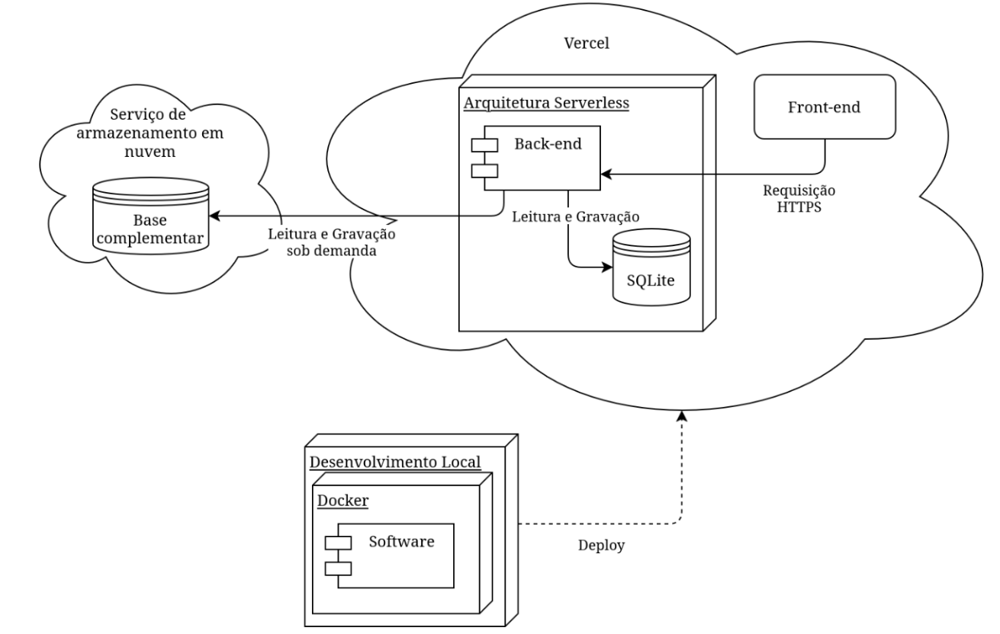

# 2.6 Visão de Implantação

### Nota de Atualização do Banco de Dados para PostgreSQL (ADR — Architectural Decision Record)

> **Decisão Arquitetural:** Migração da tecnologia de persistência de SQLite para PostgreSQL 17.  
> **Data:** 26 de outubro de 2026.  
> **Contexto:** Na versão inicial da arquitetura (v1.0), considerou-se o uso do SQLite por sua simplicidade e ausência de configuração de servidor para desenvolvimento inicial. No entanto, no ambiente de produção hospedado na Vercel por meio de Serverless Functions efêmeras, o SQLite apresenta incompatibilidade com a concorrência de escritas e impossibilidade de persistência local contínua do arquivo do banco entre execuções isoladas.  
> **Decisão:** Adotar formalmente o **PostgreSQL 17** como Sistema Gerenciador de Banco de Dados Relacional oficial do Brasil Hub.  
> **Consequências:**  
> - Em ambiente local e integração contínua (CI), utiliza-se o PostgreSQL 17 conteinerizado via Docker Compose (DOCKER, 2026), garantindo paridade de ambientes.  
> - Em ambiente de produção na nuvem, conecta-se a uma instância gerenciada de PostgreSQL (compatível com plataformas como Neon e Supabase), viabilizando conexões seguras via SSL/TLS, suporte transacional multiusuário e integridade dos dados durante requisições simultâneas.

---

O Brasil Hub é implantado em uma arquitetura de computação em nuvem apoiada na plataforma Vercel (VERCEL, 2026). A Vercel atua como provedora de hospedagem do Front-end (arquivos estáticos HTML5, CSS3 e JavaScript servidos via rede de distribuição de conteúdo — CDN) e de execução dos serviços do Back-end Python utilizando o modelo de *Serverless Functions*, processando sob demanda as requisições direcionadas à API REST.

A camada de persistência reside em um banco de dados relacional **PostgreSQL 17** gerenciado em nuvem, garantindo isolamento da base, integridade referencial, controle transacional e alta disponibilidade para atender tanto às consultas públicas de indicadores quanto às operações administrativas autenticadas.

Durante o ciclo de desenvolvimento, homologação e execução da suíte de testes automatizados, o ambiente do projeto é rigorosamente padronizado por meio de contêineres Docker (DOCKER, 2026). O arquivo `docker-compose.yml` unifica a versão da imagem do Python, as dependências do FastAPI e do Pandas, bem como a instância de serviço do PostgreSQL 17, assegurando que todos os membros da equipe e os agentes de automação do GitHub Actions operem em condições idênticas, mitigando falhas decorrentes de divergências de sistemas operacionais.

O fluxo de entrega contínua obedece à política de branches descrita no Documento de Visão e Projeto (GRUPO DIJKSTRA, 2026):
1. As implementações são desenvolvidas em branches específicas de funcionalidade (`feature/`);
2. Mediante abertura de Pull Request e aprovação por revisão de pares, os códigos são integrados à branch de desenvolvimento contínuo `developer`;
3. Ao término de cada Sprint e consolidação das entregas de valor, a branch `developer` é promovida para a branch `main`, na qual as entregas são formalizadas com a aposição de tags semânticas de release (`R1`, `R2` e `R3`), acionando o pipeline automatizado de compilação, teste e publicação contínua (*Continuous Deployment*) na Vercel e no GitHub Pages para a documentação técnica (MkDocs).

A disposição física dos nós de computação, serviços em nuvem e canais de comunicação entre as camadas está esquematizada na **Figura 7**, que apresenta o diagrama de implantação do sistema.

### Diagrama de implantação

**Figura 7 — Diagrama de Implantação**

*Fonte: Elaborado por Eduardo de Sousa (2026).*

## 2.7 Restrições adicionais

Além das metas e restrições apresentadas na Seção 2.4, o sistema observa restrições específicas nos domínios de segurança, integridade, usabilidade, infraestrutura e manutenibilidade:

### Segurança e Controle de Acesso (Requisito B-09)

O acesso às funcionalidades administrativas exige autenticação com validação de tokens temporários emitidos pelo Back-end. As credenciais de acesso de administradores não devem, sob qualquer circunstância, ser trafegadas ou armazenadas em texto simples. Emprega-se obrigatoriamente a função criptográfica de derivação de chave **`bcrypt`** com adição automática de salt individual por registro, em conformidade com as recomendações de segurança da OWASP para armazenamento seguro de senhas (OWASP, 2026).

A **Tabela 6** estabelece a matriz de controle de acesso baseada em perfis (RBAC — *Role-Based Access Control*), discriminando as permissões concedidas aos atores do sistema:

**Tabela 6 — Matriz de perfis e permissões do sistema**

| Funcionalidade / Operação | Rota / Endpoint | Visitante (Público) | Administrador (Autenticado) |
|---|---|:---:|:---:|
| Visualizar mapa interativo e camadas temáticas | `GET /` | Permitido | Permitido |
| Consultar indicadores socioeconômicos e aplicar filtros | `GET /api/indicadores` | Permitido | Permitido |
| Utilizar recursos de acessibilidade (fonte e contraste) | Client-side | Permitido | Permitido |
| Realizar autenticação (login administrativo) | `POST /api/auth/login` | Permitido | Permitido |
| Acessar painel administrativo | `GET /admin` | Bloqueado | Permitido |
| Enviar arquivos CSV para atualização da base | `POST /api/admin/indicadores/upload` | Bloqueado | Permitido |
| Consultar logs de ingestão de dados | `GET /api/admin/logs` | Bloqueado | Permitido |

*Fonte: Elaborado por Josef Wojtyla (2026).*

### Integridade dos Dados (Requisito B-04)

Todos os arquivos CSV submetidos por administradores são obrigatoriamente submetidos às rotinas de validação do módulo `src/data` antes de qualquer persistência. O sistema valida cabeçalhos, tipagem de colunas, restrições numéricas e intervalos aceitáveis. Caso qualquer inconsistência estrutural seja identificada, a operação é abortada atomicamente sem persistência parcial, retornando relatório detalhado de erros em formato JSON e preservando o estado anterior da base de dados.

### Usabilidade e Acessibilidade (Requisito B-03)

A interface deve prover mecanismos independentes de navegação acessível, incluindo ajuste escalável do tamanho tipográfico, modo noturno e paleta de alto contraste, conforme estipulado no requisito B-03. Esses controles operam integralmente no Front-end via manipuladores de CSS/DOM, sem exigir requisições ao servidor e sem degradar a visualização dos elementos gráficos e cartográficos.

### Compatibilidade e Responsividade (Requisito B-08)

O sistema deve assegurar usabilidade completa a partir da largura mínima de 360 pixels, reorganizando dinamicamente componentes de filtros e painéis informativos para layout verticalizado em telas menores, mantendo compatibilidade verificada nos navegadores Google Chrome, Mozilla Firefox e Microsoft Edge.

### Disponibilidade e Risco de Hospedagem em Nuvem

A utilização da camada gratuita da plataforma de nuvem Vercel e de serviços gerenciados de banco de dados impõe limites de quota de processamento e conexões simultâneas. Essa restrição técnica está associada ao risco arquitetural mapeado na **Tabela 8 (Gerenciamento de Riscos)** do Documento de Visão e Projeto v1.1 (GRUPO DIJKSTRA, 2026), que prevê mitigação por meio do monitoramento periódico de consumo de banda e da possibilidade de chaveamento para instâncias conteinerizadas dedicadas caso as quotas da disciplina sejam atingidas.

### Manutenibilidade e Separação de Camadas

A arquitetura em três camadas deve ser preservada em todos os ciclos de evolução do código. É vedada a incorporação de chamadas diretas de banco de dados no Front-end ou em rotas HTTP sem a intermediação dos repositórios e serviços de domínio, assegurando que eventuais refatorações em regras analíticas ou no dialeto SQL não propaguem efeitos colaterais para as demais partes da aplicação (SOMMERVILLE, 2018).
