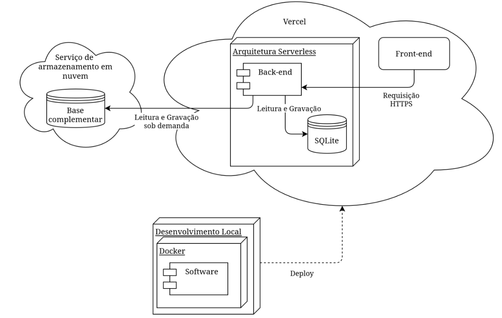

# 2.6 Visão de Implantação

O Brasil Hub será executado em uma infraestrutura de computação em nuvem utilizando a Vercel como plataforma de hospedagem da aplicação web e da API. A Vercel será responsável pela disponibilização do Front-end e pela execução do Back-end Python por meio de Functions, permitindo que as requisições sejam processadas sob demanda.

Durante o desenvolvimento e a homologação, o ambiente da aplicação será padronizado por meio de Docker, permitindo que os integrantes executem a mesma versão das dependências do projeto independentemente do sistema operacional utilizado.

O Docker é, portanto, utilizado como mecanismo de padronização do ambiente de desenvolvimento e testes, não como uma restrição de hospedagem da aplicação em produção.

A persistência dos dados utilizará PostgreSQL, conforme a decisão atual do projeto. O banco armazenará os indicadores socioeconômicos tratados e as credenciais administrativas protegidas.

A documentação do projeto será disponibilizada por meio do GitHub Pages, utilizando MkDocs, conforme definido no Documento de Visão.

### Diagrama de implantação

**Figura 7 — Diagrama de Implantação**

*Fonte: elaborado por Eduardo de Sousa.*

## 2.7 Restrições adicionais

Além das metas e restrições apresentadas na Seção 2.4, o sistema possui restrições relacionadas à segurança, usabilidade, compatibilidade, portabilidade e manutenção.

### Segurança

A área administrativa deverá ser acessível somente após autenticação. O perfil Visitante não possuirá permissão para realizar alterações nos dados.

O Administrador possuirá permissão adicional para enviar arquivos CSV e atualizar a base. As credenciais administrativas não deverão ser armazenadas em texto simples, devendo permanecer protegidas por mecanismo de hash.

### Integridade dos dados

Arquivos enviados pelo Administrador deverão passar pelas etapas de validação, tratamento e padronização antes de serem persistidos.

Arquivos que não atendam ao formato ou às regras de dados esperadas deverão ser rejeitados, evitando que informações inválidas sejam incorporadas à base utilizada pelo dashboard.

### Usabilidade e acessibilidade

A interface deverá disponibilizar os recursos de ajuste de tamanho de fonte, modo noturno e alto contraste definidos no requisito B-03.

Esses recursos não deverão impedir o acesso às informações ou aos controles essenciais da aplicação.

### Compatibilidade

A aplicação deverá permanecer utilizável em telas a partir de 360 pixels de largura e nos navegadores Chrome, Firefox e Edge, conforme o requisito B-08.

### Portabilidade

O ambiente de desenvolvimento deverá ser reproduzível por meio de Docker, permitindo a configuração uniforme das dependências e reduzindo diferenças entre os ambientes utilizados pelos integrantes.

### Manutenibilidade

A separação entre Front-end, API, serviços, autenticação, processamento de dados e persistência deverá ser preservada.

Alterações em uma camada deverão causar o mínimo possível de impacto nas demais, respeitando as interfaces estabelecidas pela arquitetura.