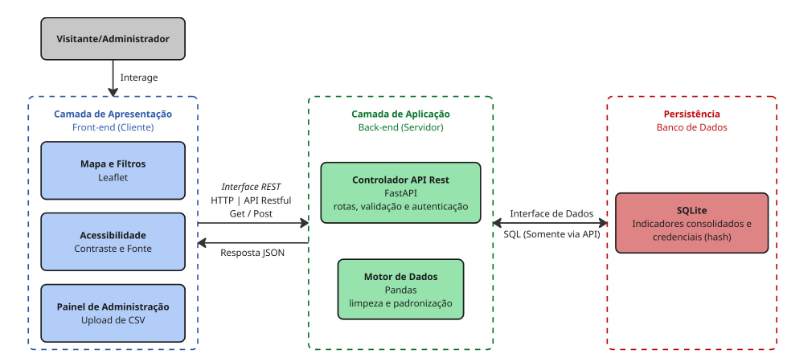

# 2. Representação Arquitetural

## 2.1 Definições

O Brasil Hub seguirá uma arquitetura Cliente-Servidor em Camadas (*Three-Tier*), composta por três níveis lógicos principais: apresentação, aplicação e persistência.

A camada de apresentação corresponde ao Front-end executado no navegador do usuário; a camada de aplicação corresponde ao Back-end desenvolvido em Python e à API RESTful implementada com FastAPI; e a camada de persistência corresponde ao banco de dados.

A separação entre essas camadas tem como objetivo reduzir o acoplamento entre interface, regras de negócio, processamento dos dados e armazenamento.

A comunicação entre o Front-end e o Back-end ocorrerá por meio da API REST, utilizando HTTP. Respostas e requisições estruturadas utilizarão JSON, enquanto o envio de arquivos CSV utilizará o formato `multipart/form-data`.

A camada de apresentação não possuirá acesso direto ao banco de dados. Todas as consultas e alterações deverão passar pela camada de aplicação, permitindo centralizar regras de validação, autenticação, autorização e tratamento dos dados.

## 2.2 Justificativa da escolha

A escolha da arquitetura Cliente-Servidor em Camadas foi motivada principalmente pela necessidade de separar responsabilidades distintas do sistema e permitir o desenvolvimento independente das partes da aplicação.

No Brasil Hub, o Front-end é responsável pela interação com o usuário, renderização do mapa interativo, aplicação dos filtros e apresentação das informações. Essas atividades utilizam JavaScript e Leaflet e possuem características predominantemente relacionadas à interface e à experiência do usuário.

O Back-end, por sua vez, é responsável pelo recebimento das requisições, aplicação das regras da aplicação, autenticação do administrador e tratamento dos dados socioeconômicos.

O uso de Python e Pandas permite concentrar as operações de leitura, validação, limpeza, padronização e transformação dos arquivos provenientes das fontes oficiais. A utilização do FastAPI permite disponibilizar essas funcionalidades por meio de uma API estruturada.

A separação entre Front-end e Back-end também reduz o acoplamento entre as equipes responsáveis pelas diferentes frentes de desenvolvimento, permitindo que alterações na interface sejam realizadas sem a necessidade de modificar diretamente o processamento dos dados e vice-versa.

Essa característica está alinhada à organização da equipe definida no Documento de Visão, que distribui responsabilidades entre desenvolvimento Front-end e Back-end.

## 2.3 Detalhamento

A arquitetura é dividida em três camadas fundamentais:

1. **Interface do Usuário (Front-end):** camada responsável pela interação com o usuário final, exibição gráfica dos mapas e interface do administrador para modificação de dados. Captura interações dos usuários e as envia para a API.

2. **Servidor de API (Back-end):** construído em FastAPI para tratar requisições, manipular dados com Pandas, executar validações e processar as consultas feitas pelos usuários.

3. **Camada de Persistência de Dados (Banco de Dados):** responsável por armazenar dados e credenciais do administrador protegidas por hash.

### Diagrama arquitetural

**Figura 1 — Diagrama Arquitetural Genérico**

*Fonte: elaborado por Lucas Nery.*

### 2.3.1 Descrição do Diagrama Arquitetural

O sistema adota o estilo arquitetural em camadas, com comunicação cliente-servidor, dividido em três camadas: apresentação, aplicação e persistência.

Cada camada tem responsabilidades bem definidas e se comunica apenas com a camada adjacente, por meio de interfaces explícitas. Isso garante separação de responsabilidades, segurança no acesso aos dados e facilidade de manutenção.

A camada de apresentação (Front-end) é uma aplicação web executada no navegador e é o ponto de interação dos dois atores do sistema: o visitante, que consulta os indicadores, e o administrador, que também mantém os dados.

Ela reúne três componentes:

- **Mapa e filtros:** implementados com Leaflet, exibem os indicadores de forma georreferenciada e interativa;
- **Acessibilidade:** permite ajustar contraste e tamanho de fonte;
- **Painel de administração:** permite ao administrador, após autenticação, enviar arquivos CSV para atualizar a base.

A camada de aplicação (Back-end) é um servidor em Python que concentra as regras do sistema.

O controlador da API REST, implementado com FastAPI, expõe as rotas, valida as requisições e autentica o administrador. O motor de dados, implementado com Pandas, realiza a limpeza, a padronização e a consolidação dos dados dos arquivos CSV, garantindo a qualidade da informação antes de seu armazenamento.

A camada de persistência armazena os indicadores consolidados e as credenciais do administrador, estas em formato hash. Esse banco só é acessado pela camada de aplicação.

A comunicação entre as camadas ocorre por dois conectores:

- **Interface REST:** liga a apresentação à aplicação, usando HTTP com requisições GET (consulta de indicadores e filtros) e POST (login e envio de CSV), e respostas em JSON ou mensagens de erro.
- **Interface de Dados:** liga a camada de aplicação à persistência por meio dos módulos responsáveis pelo acesso ao banco de dados.

Dessa forma, o controlador da API não acessa diretamente o banco de dados, e a apresentação nunca realiza acesso direto à persistência.

#### Componentes da arquitetura

**Tabela 3 — Componentes da arquitetura**

| Componente | Tecnologia | Responsabilidade | Entrada | Saída |
|---|---|---|---|---|
| Interface Web | JavaScript/Leaflet | Interação com usuários, mapas, filtros e acessibilidade | Ações do usuário | Requisições HTTP e apresentação dos resultados |
| Controlador da API | FastAPI | Receber requisições, validar dados e encaminhar operações | HTTP/JSON ou CSV | JSON, mensagens de erro ou resultado da operação |
| Serviço de Indicadores | Python | Coordenar consultas e filtros | Estado, dimensão e período | Registros filtrados |
| Serviço de Atualização | Python/Pandas | Coordenar atualização da base | Arquivo CSV | Resultado da validação e atualização |
| Módulo de Autenticação | Python | Validar credenciais e autorização | Usuário e senha/token | Autorização ou rejeição |
| Processador de Dados | Pandas | Ler, validar, limpar e padronizar dados | CSV/DataFrame | DataFrame padronizado |
| Banco de Dados | PostgreSQL | Persistir credenciais e indicadores | Consultas e alterações SQL | Registros persistidos |

*Fonte: elaborado por Josef Wojtyla (2026).*

A arquitetura apresenta três camadas principais e módulos especializados distribuídos entre elas. A camada de apresentação concentra os componentes responsáveis pela interação com os usuários. A camada de aplicação concentra a API, a autenticação, os serviços de aplicação e o processamento dos dados. A camada de persistência concentra o armazenamento das informações.

A comunicação entre as camadas ocorre por interfaces explícitas. A interface REST utiliza HTTP para transportar requisições e respostas entre o navegador e a API.

Requisições de consulta utilizam principalmente o método GET, enquanto operações que produzem alterações no sistema, como login e upload de arquivos, utilizam POST. As respostas estruturadas são representadas em JSON. O upload de arquivos CSV utiliza `multipart/form-data`, devido à necessidade de transportar o arquivo propriamente dito.

No interior do Back-end não existe uma comunicação de rede entre os módulos. A comunicação ocorre por chamadas de funções e importações entre módulos Python, seguindo a direção definida na arquitetura lógica.

O Front-end depende exclusivamente da API, a API utiliza os serviços e os módulos de autenticação, os serviços de dados utilizam o processamento e o acesso à persistência, e o módulo de autenticação consulta as credenciais armazenadas no banco.

O banco de dados armazena dois grupos principais de informações: credenciais administrativas protegidas por hash e os indicadores socioeconômicos tratados.

O Front-end nunca acessa diretamente o banco, garantindo que qualquer acesso aos dados seja intermediado pelo Back-end.

### 2.3.2 Modelo de persistência

O banco de dados do Brasil Hub será responsável por armazenar os dados socioeconômicos tratados e as informações necessárias à autenticação dos administradores.

A estrutura lógica mínima da base deverá contemplar uma tabela de administradores e uma estrutura para armazenamento dos indicadores socioeconômicos.

A tabela de administradores deverá armazenar, no mínimo:

- Um identificador;
- O nome de usuário;
- A senha protegida por hash.

A senha original não deverá ser persistida.

A estrutura dos indicadores deverá manter, no mínimo, informações referentes ao indicador, estado ou unidade territorial, dimensão socioeconômica, valor, período de referência, unidade de medida e fonte dos dados, permitindo preservar o contexto necessário para exibição e comparação.

O acesso ao banco será encapsulado pela camada de persistência, evitando que os demais módulos dependam diretamente da implementação do banco. Essa decisão reduz o acoplamento e permite uma eventual substituição da tecnologia de persistência sem alterações relevantes no Front-end ou nas regras da aplicação.

## 2.4 Metas e restrições arquiteturais

As metas e restrições arquiteturais foram definidas a partir dos requisitos funcionais e não funcionais do Documento de Visão e têm como objetivo garantir desempenho, manutenibilidade, segurança, compatibilidade e consistência estrutural do sistema.

1. **Comunicação por API REST:** a comunicação entre Front-end e Back-end deverá ocorrer exclusivamente por HTTP por meio da API REST. Requisições de consulta deverão utilizar GET, enquanto operações de criação ou alteração de dados deverão utilizar POST, respeitando a semântica dos métodos HTTP.

2. **Formato de dados:** respostas estruturadas da API deverão utilizar JSON. O envio de arquivos CSV deverá utilizar `multipart/form-data`.

3. **Desempenho:** as consultas realizadas por meio dos filtros deverão apresentar resposta da API em até 3 segundos, conforme estabelecido pelo requisito B-05. A medição deverá ser realizada em ambiente de teste controlado, utilizando o procedimento definido no roteiro de testes do projeto.

4. **Compatibilidade:** a interface deverá funcionar em telas com largura mínima de 360 pixels e nos navegadores Chrome, Firefox e Edge, sem quebra de layout ou perda das funcionalidades classificadas como MUST.

5. **Segurança:** o armazenamento de senhas administrativas deverá ser realizado exclusivamente utilizando valores de hash, impedindo o armazenamento da senha em texto simples. O acesso às operações administrativas deverá ser condicionado à autenticação e autorização do usuário.

6. **Padrão de desenvolvimento Back-end:** o código Python deverá seguir PEP 8, utilizando `snake_case` para funções e variáveis e `PascalCase` para classes.

7. **Padrão de desenvolvimento Front-end:** o código JavaScript deverá seguir as regras de lintagem definidas pelo ESLint, utilizando `camelCase` para funções e variáveis e `UPPER_SNAKE_CASE` para constantes.

8. **Controle de versão:** as alterações deverão ser realizadas em branches de funcionalidade, submetidas à revisão por pull request antes da integração à branch de integração definida pela equipe, seguindo a política de branches e Conventional Commits definida no Documento de Visão.