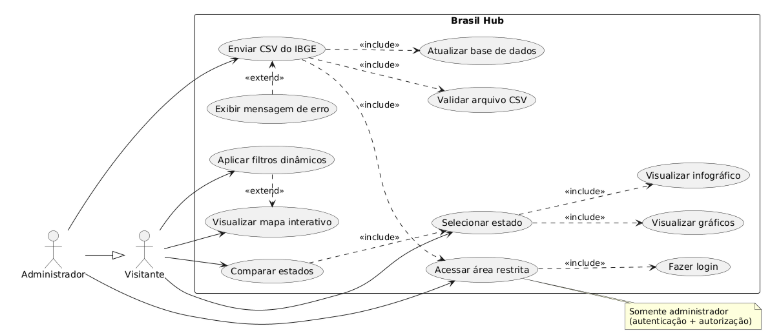
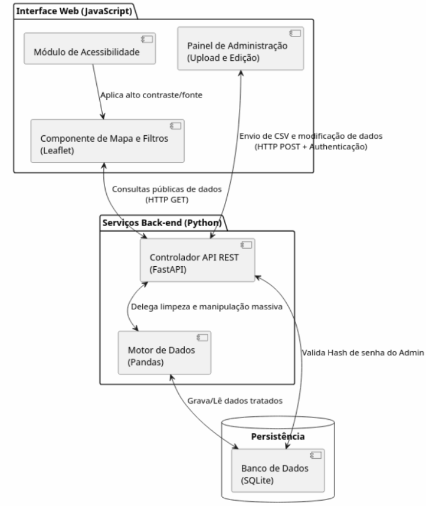
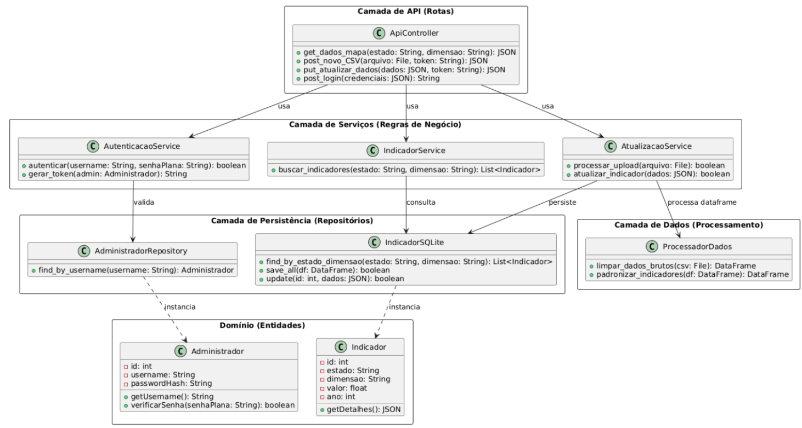

# 2.5 Visões

As diferentes visões arquiteturais apresentam o Brasil Hub sob perspectivas complementares, permitindo compreender o sistema quanto à sua utilização pelos atores, à organização lógica dos módulos, à estrutura interna dos componentes e ao ambiente no qual a aplicação será implantada.

Juntas, essas visões complementam a representação arquitetural apresentada nas seções anteriores e permitem relacionar os requisitos do produto às decisões técnicas adotadas (BASS; CLEMENTS; KAZMAN, 2021).

## 2.5.1 Visão de uso

A visão de uso apresenta o sistema a partir das funcionalidades disponíveis para os atores que interagem com o Brasil Hub. São definidos dois atores principais: o Visitante e o Administrador.

O Visitante não necessita de autenticação e pode consultar os indicadores socioeconômicos disponibilizados pelo sistema, utilizar o mapa interativo (B-01), aplicar os filtros por estado e pelas dimensões do IDH (B-02), utilizar os recursos de acessibilidade para ajuste de contraste e tamanho de fonte (B-03) e, conforme a evolução do backlog, usufruir dos recursos complementares de comparação entre estados (B-06) e gráficos analíticos (B-10).

O Administrador representa o usuário autenticado responsável pela manutenção dos dados da plataforma. Além das funcionalidades disponíveis ao Visitante, possui acesso à área administrativa restrita e pode realizar o envio de arquivos CSV do IBGE para atualização da base de dados (B-04 e B-09).

A **Figura 2** apresenta o diagrama de casos de uso do sistema, destacando os casos de uso prioritários do produto — consulta aos indicadores no mapa interativo, aplicação de filtros, utilização dos recursos de acessibilidade e gerenciamento administrativo por meio de upload de dados — evidenciando a relação de herança na qual o Administrador estende as capacidades do Visitante.

**Figura 2 — Diagrama de Casos de Uso**

*Fonte: Elaborado por Felipe George (2026).*

A funcionalidade selecionada para o diagrama de atividades é o processo de atualização da base de dados pelo Administrador, por apresentar maior quantidade de etapas e dependências entre os componentes arquiteturais. O processo envolve autenticação e autorização prévia, recepção do arquivo CSV, validação estrutural do formato, processamento analítico com a biblioteca Pandas, persistência atômica no banco de dados e notificação de sucesso ou falha ao usuário.

Esse fluxo operacional é detalhado na **Figura 3**, que apresenta o diagrama de atividades da área administrativa.

**Figura 3 — Diagrama de Atividades: Painel do Administrador**

*Fonte: Elaborado por Fabiana Reis (2026).*

A visão de uso também evidencia decisões que influenciaram a escolha do estilo arquitetural. Os requisitos de tratamento e padronização dos arquivos CSV, desempenho da API (B-05), segurança da área administrativa (B-09) e separação entre interface e processamento justificam a utilização da arquitetura Cliente-Servidor em Camadas. Dessa maneira, o navegador concentra a apresentação dos dados, enquanto o servidor concentra o processamento, as regras de acesso e a persistência.

## 2.5.2 Visão de organização lógica

O Brasil Hub é organizado logicamente em seis módulos principais, distribuídos entre as camadas da arquitetura. A divisão foi definida para concentrar responsabilidades afins e minimizar dependências entre os componentes.

- `src/frontend`: concentra a apresentação e a interação com o usuário;
- `src/api`: representa a fronteira de comunicação HTTP entre o navegador e o Back-end;
- `src/services`: concentra as regras de negócio e a coordenação das operações da aplicação;
- `src/data`: concentra a ingestão, validação, transformação e disponibilização dos dados;
- `src/auth`: concentra as responsabilidades de autenticação, autorização e hashing de senhas;
- `src/database`: encapsula o acesso ao banco de dados relacional.

A **Tabela 4** sintetiza as responsabilidades e a camada de cada módulo na arquitetura do sistema.

**Tabela 4 — Tabela de Módulos**

| Camada | Módulo | Papel resumido |
|---|---|---|
| Interface | `src/frontend` | Dashboard, mapa interativo, filtros, acessibilidade e painel do administrador |
| API | `src/api` | Rotas HTTP, validação de esquemas e contratos de entrada e saída |
| Lógica de aplicação | `src/services` | Coordenação das consultas analíticas e da atualização da base |
| Segurança | `src/auth` | Autenticação, autorização e proteção das senhas via hash |
| Dados | `src/data` | Leitura, validação, tratamento e acesso aos indicadores socioeconômicos |
| Persistência | `src/database` | Conexão e repositórios para persistência de credenciais e indicadores |

*Fonte: Elaborado por Ágatha Natasha (2026).*

### 2.5.2.1 Razão lógica de cada módulo

#### `src/frontend` — JavaScript e Leaflet

Concentra a interface gráfica manipulada pelo usuário. Organiza o código separando as páginas (`pages/`), os componentes reutilizáveis de mapa e filtros (`components/`), os recursos de acessibilidade de fonte e alto contraste (`accessibility/`), o cliente HTTP de envio de requisições (`api_client/`) e os estilos e recursos estáticos (`assets/`). Dessa forma, a interface pode evoluir esteticamente sem impactar as regras da aplicação.

#### `src/api` — FastAPI

Constitui o ponto de entrada do Back-end, recebendo as requisições HTTP do cliente e devolvendo respostas estruturadas. Cada rota atende a uma responsabilidade específica: consulta de indicadores (`indicators.py`), upload de arquivos pelo administrador (`admin.py`) e autenticação (`auth.py`). Os esquemas do Pydantic em `schemas/` formalizam os contratos de dados na borda do sistema, assegurando que apenas requisições válidas atinjam a lógica interna.

#### `src/services`

Posiciona-se como camada intermediária entre as rotas HTTP e o tratamento de dados. O módulo `indicators.py` coordena as consultas e os filtros temáticos, enquanto `updates.py` gerencia o fluxo de atualização da base de dados. Com isso, os endpoints HTTP atuam como controladores leves, permitindo testar e manter a lógica de negócio independentemente do framework web.

#### `src/data` — Pandas

Responsável pelo ciclo de vida e qualidade dos dados dos indicadores socioeconômicos:
- `ingestion.py`: realiza a leitura dos arquivos brutos em formato CSV;
- `validation.py`: verifica o esquema tabular, tipos e restrições de nulidade;
- `processing.py`: executa a higienização, normalização e cálculo de médias;
- `storage.py`: gerencia as coleções de indicadores consolidados.

Isolar o tratamento em um módulo especializado assegura que apenas dados íntegros e consistentes sejam disponibilizados para exibição.

#### `src/auth`

Centraliza a segurança e o controle de acesso à área administrativa:
- `authentication.py`: verifica a autenticidade do usuário no processo de login;
- `permissions.py`: valida autorizações para execução de operações administrativas restritas;
- `password_hash.py`: executa a geração e verificação de hashes de senhas via `bcrypt`.

#### `src/database`

Encapsula o acesso ao banco de dados SQLite. O módulo `connection.py` gerencia a conexão com o arquivo de banco de dados e as operações transacionais, enquanto os repositórios (`admin_repository.py` e `indicator_repository.py`) executam as instruções SQL para persistir e recuperar tanto as credenciais administrativas quanto a totalidade dos registros de indicadores socioeconômicos tratados. Dessa forma, nenhuma regra de persistência vaza para as camadas de apresentação ou serviços.

### 2.5.2.2 Comunicação entre os módulos

As dependências entre os módulos seguem uma direção única e estritamente hierárquica, reduzindo o acoplamento:

- O módulo `frontend` interage unicamente com o módulo `api`;
- O módulo `api` aciona os serviços de `services` e as rotas de segurança de `auth`;
- O módulo `services` coordena as operações do módulo `data`;
- O módulo `data` persiste e consulta dados por meio do módulo `database`;
- O módulo `auth` consulta e valida credenciais administrativas por intermédio do módulo `database`.

A **Tabela 5** detalha as formas de comunicação e as interfaces utilizadas entre os módulos do sistema.

**Tabela 5 — Comunicação entre os módulos**

| Origem → Destino | Forma de comunicação | Interface |
|---|---|---|
| `frontend → api` | Requisições HTTP feitas por `api_client/`, com dados estruturados em JSON | Rotas REST de consulta de indicadores e login |
| `frontend → api` (upload) | Envio de arquivo CSV codificado em `multipart/form-data` | Rota REST de upload em `routes/admin.py` |
| `api → services` | Chamadas diretas de funções e métodos Python | Módulos `indicators.py` e `updates.py` |
| `api → auth` | Chamadas diretas de funções e métodos Python | Funções de validação de token e credenciais |
| `services → data` | Chamadas diretas de funções e métodos Python | Módulos de ingestão, validação e higienização |
| `auth → database` | Chamadas de funções do repositório de administradores | Módulo `admin_repository.py` |
| `data → database` | Chamadas de funções do repositório de indicadores | Módulo `indicator_repository.py` e conexão SQL |

*Fonte: Elaborado por Ágatha Natasha (2026).*

O arranjo estrutural desses pacotes e suas dependências unidirecionais estão formalizados no diagrama de pacotes da **Figura 4**.

### Diagrama de pacotes

**Figura 4 — Diagrama de Pacotes**

*Fonte: Elaborado por Ágatha Natasha (2026).*

## 2.5.3 Visão estrutural

A visão estrutural detalha os componentes de execução e as classes que materializam a arquitetura do Brasil Hub. Enquanto a visão lógica organiza o código por responsabilidade funcional, a visão estrutural evidencia as entidades de software e seus relacionamentos durante a execução do sistema (BASS; CLEMENTS; KAZMAN, 2021).

Na camada de apresentação, os componentes de interface (mapa Leaflet, seletores de filtros, módulo de acessibilidade e formulário administrativo) realizam requisições assíncronas à API. Na camada de aplicação, o controlador FastAPI recebe os dados, valida os schemas Pydantic e aciona os serviços de indicadores ou de ingestão. O processamento com Pandas valida o layout dos arquivos enviados e consolida os números antes de delegar a gravação à persistência.

A persistência de dados é organizada por meio do padrão *Repository*, dividida em `IndicadorRepository` (responsável pelo ciclo de armazenamento e recuperação de indicadores) e `AdminRepository` (responsável pela consulta de credenciais de administradores). O escopo funcional do sistema contempla unicamente a consulta pública e a importação/substituição de dados via arquivo CSV, não havendo funcionalidades de edição manual de registros individuais.

O diagrama de componentes da **Figura 5** ilustra as dependências e interfaces de execução entre os módulos do sistema.

### Diagrama de componentes

**Figura 5 — Diagrama de Componentes**

*Fonte: Elaborado por César Augusto (2026).*

O modelo estrutural de dados e suas operações está detalhado no diagrama de classes da **Figura 6**, apresentando as entidades de domínio, os serviços de processamento, as classes de repositório (`IndicadorRepository` e `AdminRepository`) e os componentes de controle de Autenticação e Autorização.

### Diagrama de classes

**Figura 6 — Diagrama de Classes**

*Fonte: Elaborado por César Augusto (2026).*
