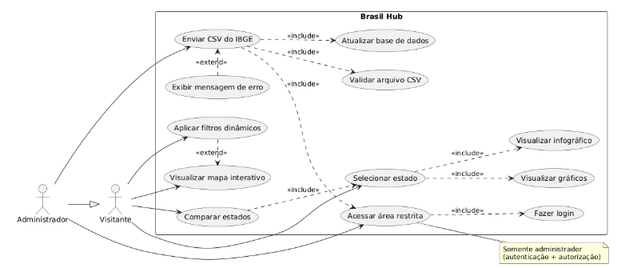
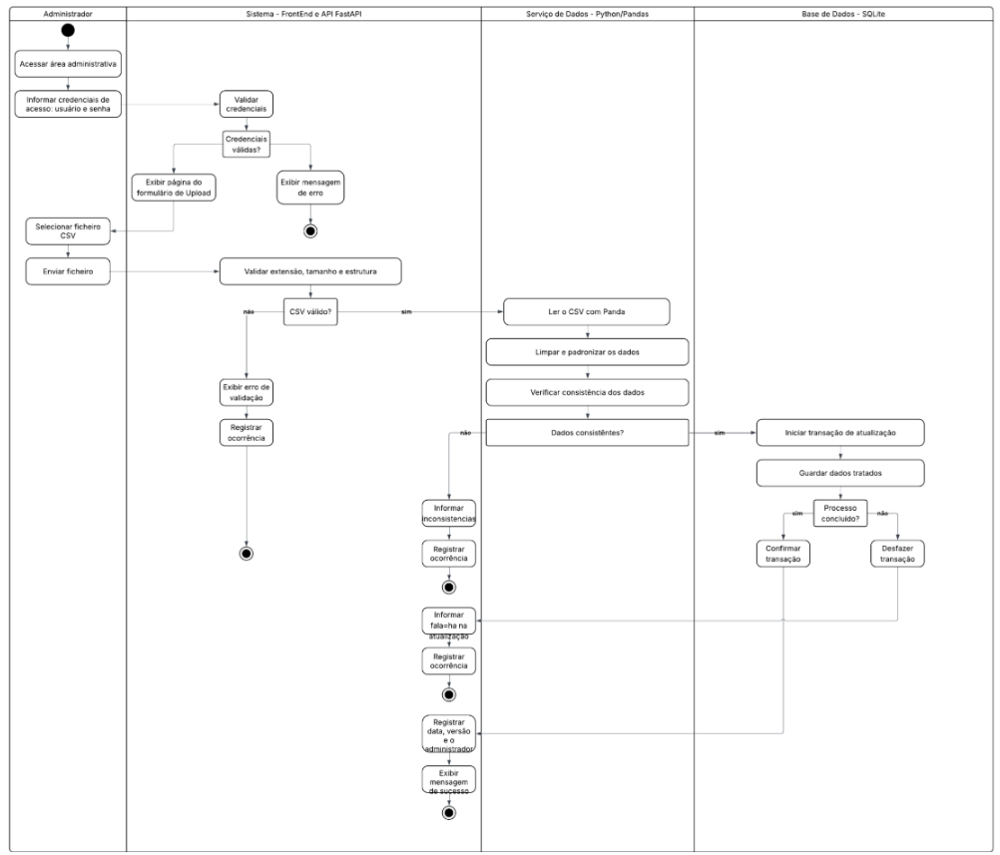
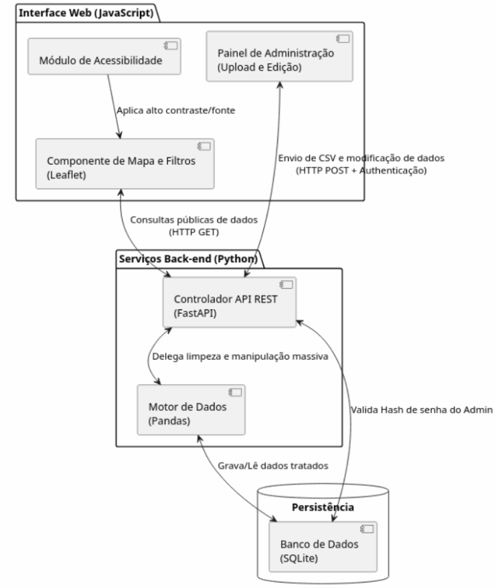
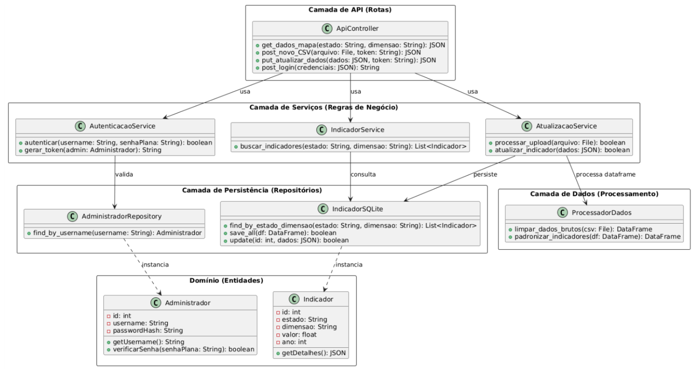

# 2.5 Visões

As diferentes visões arquiteturais apresentam o Brasil Hub sob perspectivas complementares, permitindo compreender o sistema quanto à sua utilização pelos atores, à organização lógica dos módulos, à estrutura interna dos componentes e ao ambiente no qual a aplicação será implantada.

Juntas, essas visões complementam a representação arquitetural apresentada nas seções anteriores e permitem relacionar os requisitos do produto às decisões técnicas adotadas.

## 2.5.1 Visão de uso

A visão de uso apresenta o sistema a partir das funcionalidades disponíveis para os atores que interagem com o Brasil Hub. São definidos dois atores principais: o Visitante e o Administrador.

O Visitante não necessita de autenticação e pode consultar os indicadores socioeconômicos disponibilizados pelo sistema, utilizar o mapa interativo, aplicar os filtros por estado e pelas dimensões do IDH, utilizar os recursos de acessibilidade e, quando implementados, utilizar os recursos complementares de comparação, tabelas, linha do tempo e exportação de dados.

O Administrador representa o usuário autenticado responsável pela manutenção dos dados da plataforma. Além das funcionalidades disponíveis ao Visitante, possui acesso à área administrativa e pode realizar o envio de arquivos CSV do IBGE para atualização da base de dados.

A Figura 2 apresenta o diagrama de casos de uso do sistema, destacando a generalização do Administrador em relação ao Visitante, uma vez que o perfil administrativo também possui as funcionalidades de consulta disponibilizadas ao público.

**Figura 2 — Diagrama de Caso de Uso**

*Fonte: produzido por Felipe George.*

A funcionalidade selecionada para o diagrama de atividades é o processo de atualização da base de dados pelo Administrador, por apresentar maior quantidade de etapas e dependências entre os componentes arquiteturais.

O processo envolve autenticação, autorização, envio do arquivo, validação do formato, processamento dos dados, persistência das informações e retorno do resultado ao usuário.

**Figura 3 — Diagrama de Atividades: Painel do Administrador**

*Fonte: produzido por Fabiana Reis.*

A visão de uso também evidencia decisões que influenciaram a escolha do estilo arquitetural. Os requisitos de tratamento e padronização dos arquivos, desempenho da API, segurança da área administrativa e separação entre interface e processamento justificam a utilização da arquitetura Cliente-Servidor em Camadas.

Dessa maneira, o navegador concentra a apresentação dos dados, enquanto o servidor concentra o processamento, as regras de acesso e a persistência.

## 2.5.2 Visão de organização lógica

O Brasil Hub é organizado logicamente em seis módulos principais, distribuídos entre as camadas da arquitetura. A divisão foi definida para concentrar responsabilidades relacionadas e minimizar dependências desnecessárias entre os componentes.

- `src/frontend`: concentra a apresentação e a interação com o usuário.
- `src/api`: representa a fronteira de comunicação entre o navegador e o Back-end.
- `src/services`: concentra as regras e a coordenação das operações da aplicação.
- `src/data`: concentra a ingestão, validação, transformação e disponibilização dos dados.
- `src/auth`: concentra as responsabilidades de autenticação e autorização e atua como módulo transversal de segurança.
- `src/database`: encapsula o acesso ao banco de dados.

As dependências seguem uma direção única, reduzindo o acoplamento entre os módulos. O Front-end utiliza a API; a API utiliza os serviços e a autenticação; os serviços utilizam os módulos de dados; os módulos de dados utilizam a persistência; e a autenticação utiliza a persistência para consultar as credenciais administrativas.

Dessa forma, o Front-end não possui conhecimento da estrutura interna do banco de dados, e os módulos de apresentação não implementam regras de persistência diretamente.

### Tabela 4 — Tabela de Módulos

| Camada | Módulo | Papel resumido |
|---|---|---|
| Interface | `src/frontend` | Dashboard, mapas, filtros, acessibilidade e área administrativa |
| API | `src/api` | Rotas HTTP e contratos de entrada e saída |
| Lógica de aplicação | `src/services` | Coordenação das consultas e da atualização da base |
| Segurança | `src/auth` | Autenticação, autorização e proteção das senhas |
| Dados | `src/data` | Leitura, validação, tratamento e acesso aos indicadores |
| Persistência | `src/database` | Acesso às credenciais administrativas e aos indicadores |

*Fonte: produzido por Ágatha Natasha.*

### 2.5.2.1 Razão lógica de cada módulo

#### `src/frontend` — JavaScript e Leaflet

Concentra tudo o que o usuário vê e manipula. Separa as páginas (`pages/`) dos componentes reutilizáveis de mapa e filtros (`components/`), dos recursos de acessibilidade de fonte e contraste (`accessibility/`), do envio de requisições (`api_client/`) e dos estilos e recursos (`assets/`).

Assim, a aparência pode mudar sem afetar as regras do sistema, e o acesso à API fica em um único ponto.

#### `src/api` — FastAPI

É a fronteira do Back-end: recebe as requisições do navegador e devolve as respostas.

Cada rota tem uma responsabilidade: consultas de indicadores (`indicators.py`), upload de CSV pela administração (`admin.py`) e login (`auth.py`).

Os diretórios `schemas/` definem os contratos de entrada e saída, de modo que a validação do formato fica na borda do sistema e a lógica interna não depende dela.

#### `src/services`

Fica entre as rotas e o tratamento de dados. `indicators.py` coordena as consultas e os filtros por estado e pelas dimensões do IDH/IDHM, enquanto `updates.py` coordena a atualização da base.

Com isso, as rotas apenas delegam, e as regras de negócio podem ser alteradas ou testadas sem depender do protocolo HTTP.

#### `src/data` — Pandas

Reúne o ciclo de vida dos indicadores:

- `ingestion.py`: lê o CSV;
- `validation.py`: verifica estrutura e valores;
- `processing.py`: realiza limpeza e padronização;
- `storage.py`: dá acesso aos indicadores já tratados.

Isolar esse ciclo mantém a qualidade dos dados em um só lugar e evita que dados inválidos cheguem ao dashboard.

#### `src/auth`

Protege a área administrativa.

- `authentication.py`: confirma a identidade de quem faz login;
- `permissions.py`: decide se o usuário pode executar determinada ação, como atualizar a base;
- `password_hash.py`: garante que as senhas sejam armazenadas protegidas.

Mantê-lo separado concentra as regras de segurança, que podem ser revisadas e evoluídas sem alterar o restante do sistema.

#### `src/database`

Encapsula o acesso ao banco de dados. `connection.py` gerencia a conexão e `admin_repository.py` consulta as credenciais.

Apenas esse módulo conhece os detalhes de persistência; se o banco for trocado no futuro, o impacto deverá ser minimizado pela separação dessa responsabilidade.

### 2.5.2.2 Comunicação entre os módulos

As dependências seguem uma direção única, reduzindo o acoplamento entre os módulos.

- O Front-end utiliza a API.
- A API utiliza os serviços e o módulo de autenticação.
- Os serviços utilizam o módulo de dados.
- O módulo de dados utiliza a persistência.
- O módulo de autenticação utiliza a persistência para consultar as credenciais administrativas.

### 2.5.2.3 Fluxos principais

A organização lógica pode ser compreendida a partir de dois fluxos principais.

#### Fluxo de consulta

No fluxo de consulta, o Visitante interage com a interface web e seleciona os critérios desejados.

O Front-end envia uma requisição HTTP para a API, que valida os parâmetros e encaminha a operação para o serviço responsável.

O serviço consulta os dados tratados por meio da camada de dados e da persistência, retornando à API os registros correspondentes.

A API transforma o resultado em JSON e o envia ao Front-end, que atualiza a visualização do mapa, tabela ou gráfico.

**Fluxo resumido:**

`frontend → api → services → data → database`

#### Fluxo de atualização

No fluxo de atualização, o Administrador realiza a autenticação e, após autorização, envia um arquivo CSV pela área administrativa.

A API recebe o arquivo, encaminha-o aos serviços responsáveis e o módulo de dados realiza a leitura, validação, limpeza e padronização utilizando Pandas.

Após a validação, os dados são persistidos no banco e o resultado da operação é retornado ao Administrador.

**Fluxo resumido:**

- Autenticação: `api → auth → database`
- Atualização: `api → services → data → database`

Essa divisão permite que a lógica de apresentação, as regras da aplicação, o processamento dos dados, a segurança e a persistência permaneçam isolados, facilitando a manutenção e a realização de testes.

### Tabela 5 — Comunicação entre os módulos

| Origem → Destino | Forma de comunicação | Interface |
|---|---|---|
| `frontend → api` | Requisições HTTP feitas por `api_client/`, com dados em JSON | Rotas HTTP de consulta de indicadores, login e atualização da base |
| `frontend → api` (upload) | Envio do arquivo CSV por `multipart/form-data`, pela área administrativa | Rota de upload em `routes/admin.py` |
| `api → services` | Importação de módulos e chamada de funções Python | Funções de `indicators.py` e `updates.py` |
| `api → auth` | Importação de módulos e chamada de funções Python | Funções de autenticação e autorização |
| `services → data` | Importação de módulos e chamada de funções Python | Funções de ingestão, validação, tratamento e acesso aos indicadores |
| `auth → database` | Importação de módulos e chamada de funções Python | Funções de `admin_repository.py` para consultar credenciais |
| `data → database` | Importação de módulos e chamadas de funções Python | Funções de persistência dos indicadores e conexão com o banco |

*Fonte: produzido por Ágatha Natasha.*

Em resumo, a comunicação entre o navegador e o servidor usa HTTP com JSON, e o CSV do upload segue por `multipart/form-data`. Dentro do Back-end, os módulos Python se comunicam por importações e chamadas de função, sem protocolo de rede.

### Diagrama de pacotes

**Figura 4 — Diagrama de Pacotes**

*Fonte: produzido por Ágatha Natasha.*

## 2.5.3 Visão estrutural

A visão estrutural apresenta os principais elementos internos do Brasil Hub e as relações entre eles, complementando a visão lógica apresentada anteriormente.

Enquanto a visão lógica organiza os módulos por responsabilidade, a visão estrutural apresenta os componentes que participam diretamente da execução do sistema e as relações existentes entre eles.

Na camada de apresentação estão os componentes responsáveis pela interface web, incluindo o mapa interativo, os filtros, os recursos de acessibilidade e o painel administrativo. Esses componentes utilizam a API como única interface de comunicação com o Back-end.

Na camada de aplicação, o controlador da API recebe as requisições, valida os parâmetros e encaminha as operações para os serviços responsáveis. O processador de dados utiliza Pandas para executar as etapas de leitura, validação, limpeza e padronização dos dados. O módulo de autenticação valida as credenciais e verifica as permissões necessárias para as operações administrativas.

Na camada de persistência, o banco de dados é acessado por meio dos repositórios responsáveis pelas operações de persistência das entidades correspondentes.

O repositório de indicadores trata da persistência dos indicadores socioeconômicos, enquanto o repositório de administradores realiza as operações relacionadas às credenciais administrativas.

Essa separação impede que os componentes de apresentação ou os atores externos acessem diretamente o banco de dados e reduz o acoplamento entre a aplicação e a tecnologia de persistência.

O diagrama de componentes apresenta as dependências entre os principais componentes de execução. O diagrama de classes apresenta as entidades e serviços necessários para representar as responsabilidades estruturais do sistema, devendo manter a separação entre atores externos, componentes de aplicação e entidades persistentes.

### Diagrama de componentes

**Figura 5 — Diagrama de Componentes**

*Fonte: elaborado por César Augusto.*

### Diagrama de classes

**Figura 6 — Diagrama de Classes**

*Fonte: elaborado por César Augusto.*