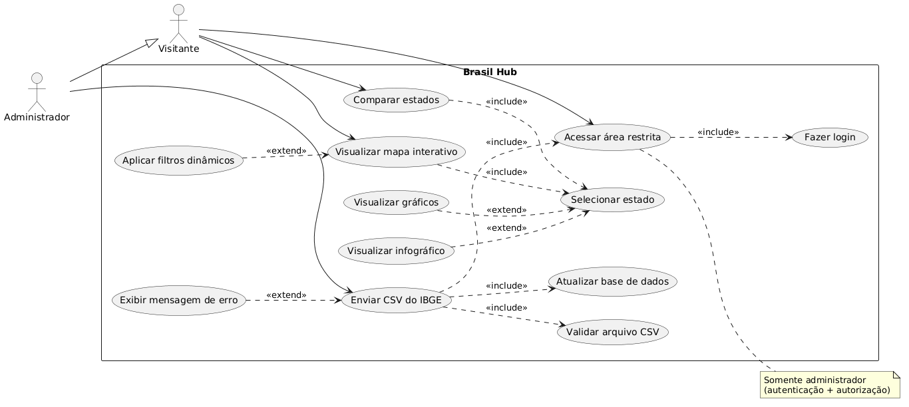
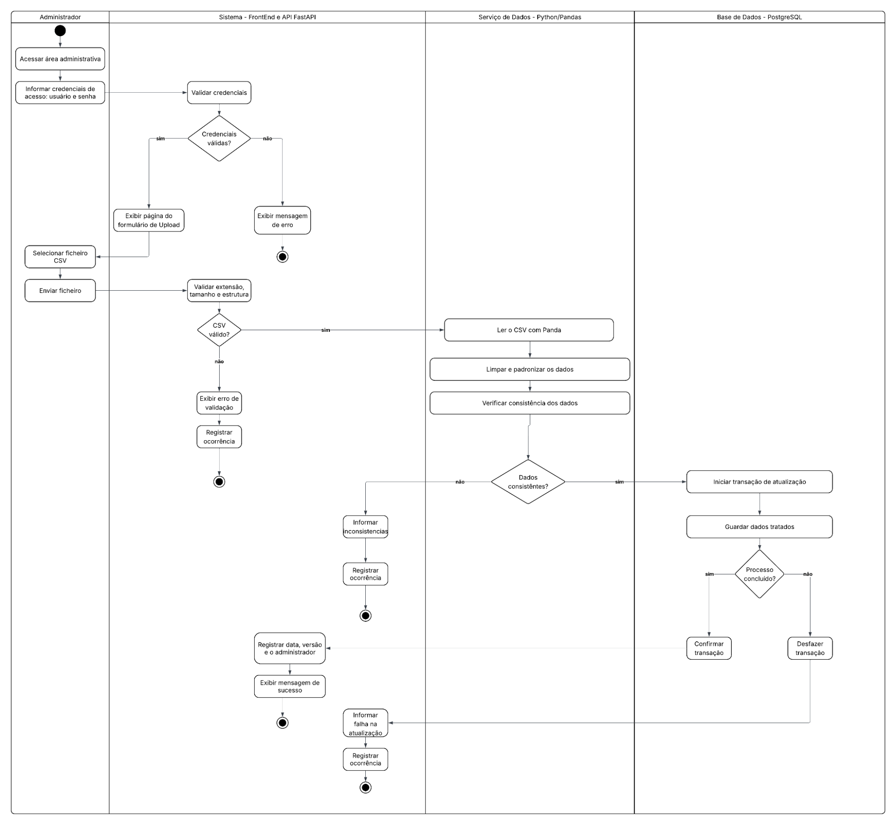
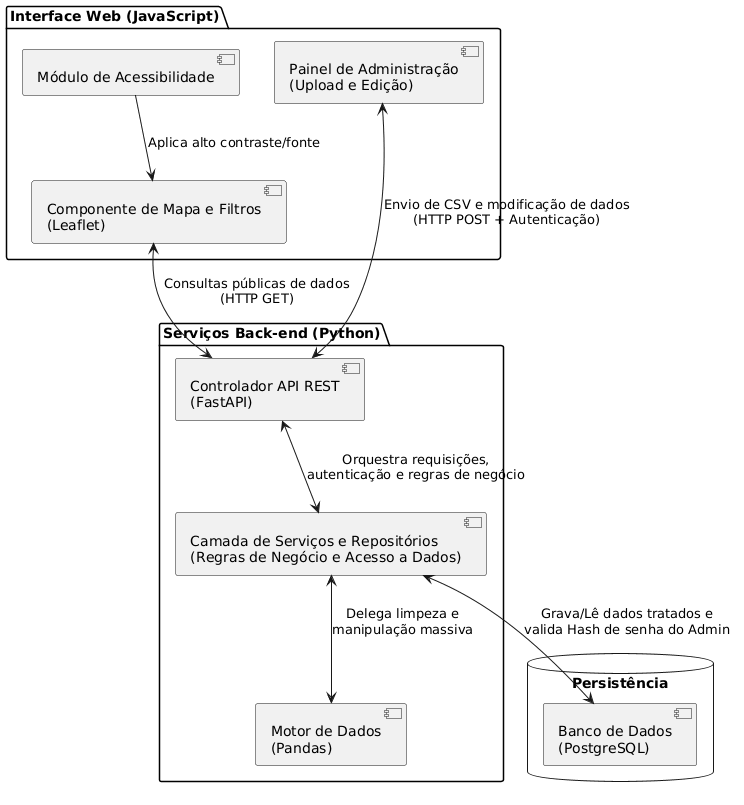
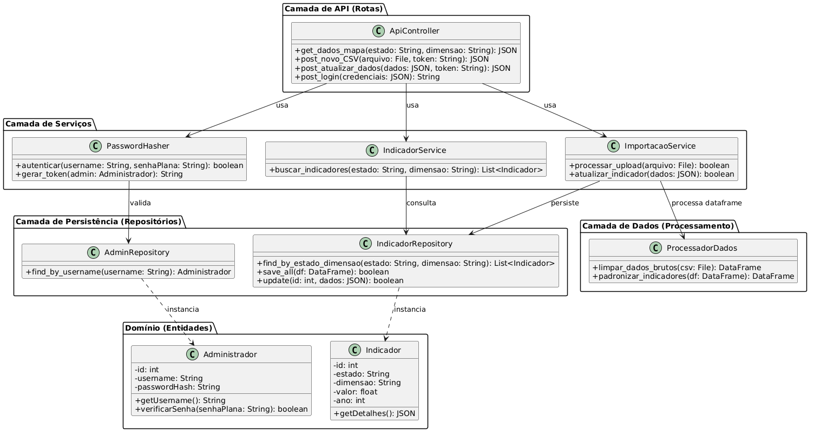

# 2.5 Visões

As diferentes visões arquiteturais apresentam o Brasil Hub sob perspectivas complementares, permitindo compreender o sistema quanto à sua utilização pelos atores, à organização lógica dos módulos, à estrutura interna dos componentes e ao ambiente no qual a aplicação será implantada.

Juntas, essas visões complementam a representação arquitetural apresentada nas seções anteriores e permitem relacionar os requisitos do produto às decisões técnicas adotadas (BASS; CLEMENTS; KAZMAN, 2021).

## 2.5.1 Visão de uso

A visão de uso apresenta o sistema a partir das funcionalidades disponíveis para os atores que interagem com o Brasil Hub. São definidos dois atores principais: o Visitante e o Administrador.

O Visitante não necessita de autenticação e pode consultar os indicadores socioeconômicos disponibilizados pelo sistema, utilizar o mapa interativo (B-01), aplicar os filtros por estado e pelas dimensões do IDH (B-02), utilizar os recursos de acessibilidade para ajuste de contraste e tamanho de fonte (B-03) e, conforme a evolução do backlog, usufruir dos recursos complementares de comparação entre estados (B-06) e gráficos analíticos (B-10).

O Administrador representa o usuário autenticado responsável pela manutenção dos dados da plataforma. Além das funcionalidades disponíveis ao Visitante, possui acesso à área administrativa restrita e pode realizar o envio de arquivos CSV do IBGE para atualização da base de dados (B-04 e B-09).

A **Figura 2** apresenta o diagrama de casos de uso do sistema, destacando os casos de uso prioritários do produto — consulta aos indicadores no mapa interativo, aplicação de filtros, utilização dos recursos de acessibilidade e gerenciamento administrativo por meio de upload de dados — evidenciando a relação de herança na qual o Administrador estende as capacidades do Visitante.

**Figura 2 — Diagrama de Casos de Uso**

*Fonte: Elaborado por Felipe George (2026).*

A funcionalidade selecionada para o diagrama de atividades é o processo de atualização da base de dados pelo Administrador, por apresentar maior quantidade de etapas e dependências entre os componentes arquiteturais. O processo envolve autenticação e autorização prévia, recepção do arquivo CSV, validação estrutural do formato, processamento analítico com a biblioteca Pandas, persistência atômica no banco de dados e notificação de sucesso ou falha ao usuário.

Esse fluxo operacional é detalhado na **Figura 3**, que apresenta o diagrama de atividades da área administrativa.

**Figura 3 — Diagrama de Atividades: Painel do Administrador**

*Fonte: Elaborado por Fabiana Reis (2026).*

A visão de uso também evidencia decisões que influenciaram a escolha do estilo arquitetural. Os requisitos de tratamento e padronização dos arquivos CSV, desempenho da API (B-05), segurança da área administrativa (B-09) e separação entre interface e processamento justificam a utilização da arquitetura Cliente-Servidor em Camadas. Dessa maneira, o navegador concentra a apresentação dos dados, enquanto o servidor concentra o processamento, as regras de acesso e a persistência.

## 2.5.2 Visão de organização lógica

O Brasil Hub é organizado logicamente em seis módulos principais, distribuídos entre as camadas da arquitetura. A divisão foi definida para concentrar responsabilidades afins e minimizar dependências entre os componentes.

- `src/frontend`: concentra a apresentação e a interação com o usuário;
- `src/api`: representa a fronteira de comunicação HTTP entre o navegador e o Back-end;
- `src/services`: concentra as regras de negócio e a coordenação das operações da aplicação;
- `src/data`: concentra a ingestão, validação, transformação e disponibilização dos dados;
- `src/auth`: concentra as responsabilidades de autenticação, autorização e hashing de senhas;
- `src/database`: encapsula o acesso ao banco de dados relacional.

A **Tabela 4** sintetiza as responsabilidades e a camada de cada módulo na arquitetura do sistema.

**Tabela 4 — Tabela de Módulos**

| Camada | Módulo | Papel resumido |
|---|---|---|
| Interface | `src/frontend` | Dashboard, mapa interativo, filtros, acessibilidade e painel do administrador |
| API | `src/api` | Rotas HTTP, validação de esquemas e contratos de entrada e saída |
| Lógica de aplicação | `src/services` | Coordenação das consultas analíticas e da atualização da base |
| Segurança | `src/auth` | Autenticação, autorização e proteção das senhas via hash |
| Dados | `src/data` | Leitura, validação, tratamento e acesso aos indicadores socioeconômicos |
| Persistência | `src/database` | Conexão e repositórios para persistência de credenciais e indicadores |

*Fonte: Elaborado por Ágatha Natasha (2026).*

### 2.5.2.1 Razão lógica de cada módulo

#### `src/frontend` — JavaScript e Leaflet

Concentra a camada de apresentação e todos os elementos de interface com os quais o usuário interage diretamente. Organiza as páginas HTML na raiz, separando-as das folhas de estilo (`css/`), dos scripts de comportamento e comunicação com a API (`js/`) e dos recursos gráficos e geográficos em (`assets/`). Dessa forma, a interface pode evoluir sem afetar as regras de negócio.

#### `src/api` — FastAPI

É a fronteira do back-end: recebe as requisições do navegador e devolve as respostas. Cada rota tem uma responsabilidade: consultas de indicadores , upload de CSV pela administração e login. O módulo `schemas.py` define os contratos de entrada e saída, de modo que a validação do formato fica na borda do sistema e a lógica interna não depende dela.

#### `src/services`

Atua como camada intermediária entre as rotas da API e o módulo de tratamento de dados. O módulo `indicador_service.py` define duas classes principais:
- IndicadorService, responsável por coordenar as consultas e os filtros por estado e pelas dimensões do IDH e do IDHM;
- ImportacaoService, encarregada de coordenar a atualização da base de dados. Dessa forma, as rotas restringem-se a delegar as requisições, permitindo que as regras de negócio sejam alteradas ou testadas de maneira independente do protocolo HTTP.

#### `src/data` — Pandas

Concentra o ciclo de ingestão, validação, transformação, mapeamento e carga inicial dos indicadores socioeconômicos, estruturado em três arquivos principais: 
- `processamento_csv.py`: responsável por realizar a leitura dos arquivos CSV, normalizar os identificadores das Unidades da Federação, reestruturar as colunas anuais em registros tabulares e descartar valores fora do intervalo válido; 
- `mapeamento_indicadores.py`: encarregado de adequar o DataFrame tratado ao esquema lógico exigido pela camada de persistência, incorporando metadados como unidade de medida e fonte; 
- `importar_csv.py`: que orquestra o processamento em lote das bases brutas, verifica a existência prévia de registros para evitar duplicações e aciona a gravação dos dados consolidados no PostgreSQL.

Isolar esse fluxo assegura a qualidade e a padronização das informações antes do armazenamento, impedindo que dados inválidos cheguem ao dashboard.

#### `src/auth`

É responsável pela proteção da área administrativa e pelo controle de acesso às operações restritas do sistema:

- `security.py` define a classe PasswordHasher, encarregada de aplicar algoritmos de hash criptográfico às senhas antes de seu armazenamento e de validar as credenciais submetidas durante o processo de autenticação (login).

#### `src/database`

Encapsula a conexão em rede e as operações de persistência no banco de dados relacional, centralizando tanto o armazenamento dos indicadores socioeconômicos consolidados quanto das credenciais administrativas. O módulo está estruturado em três arquivos principais: 

- `database.py`: responsável por gerenciar o ciclo de vida das conexões com o PostgreSQL, além de inicializar o esquema relacional das tabelas indicadores e administradores;
- `admin_repository.py`: que define a classe AdminRepository, encarregada de consultar e persistir os usuários administradores e suas senhas protegidas por hash;
- `indicador_repository.py`: que define a classe IndicadorRepository, responsável por executar consultas filtradas e operações em lote de inserção e atualização dos indicadores tratados. 

Isolar o acesso aos dados nesse pacote impede que as demais camadas dependam diretamente do Sistema Gerenciador de Banco de Dados ou de instruções SQL, permitindo que uma eventual substituição da tecnologia de persistência ocorra sem impactar as regras de negócio ou a camada de apresentação.

### 2.5.2.2 Comunicação entre os módulos

As dependências entre os módulos seguem uma direção única e estritamente hierárquica, reduzindo o acoplamento:

- O módulo `frontend` interage unicamente com o módulo `api`;
- O módulo `api` aciona os serviços de `services` e as rotas de segurança de `auth`;
- O módulo `services` coordena as operações do módulo `data`;
- O módulo `data` persiste e consulta dados por meio do módulo `database`;
- O módulo `auth` consulta e valida credenciais administrativas por intermédio do módulo `database`.

A **Tabela 5** detalha as formas de comunicação e as interfaces utilizadas entre os módulos do sistema.

**Tabela 5 — Comunicação entre os módulos**

| Origem → Destino | Forma de comunicação | Interface |
|---|---|---|
| `frontend → api` | Requisições HTTP feitas por `api_client/`, com dados estruturados em JSON | Rotas REST de consulta de indicadores e login |
| `frontend → api` (upload) | Envio de arquivo CSV codificado em `multipart/form-data` | Rota REST de upload em `routes/admin.py` |
| `api → services` | Chamadas diretas de funções e métodos Python | Módulo `indicator_service.py`|
| `api → auth` | Chamadas diretas de funções e métodos Python | Funções de validação de token e credenciais |
| `services → data` | Chamadas diretas de funções e métodos Python | Módulos de ingestão, validação e higienização |
| `auth → database` | Chamadas de funções do repositório de administradores | Módulo `admin_repository.py` |
| `data → database` | Chamadas de funções do repositório de indicadores | Módulo `indicator_repository.py` e conexão SQL |

*Fonte: Elaborado por Ágatha Natasha (2026).*

O arranjo estrutural desses pacotes e suas dependências unidirecionais estão formalizados no diagrama de pacotes da **Figura 4**.

### Diagrama de pacotes

**Figura 4 — Diagrama de Pacotes**

*Fonte: Elaborado por Ágatha Natasha (2026).*

## 2.5.3 Visão estrutural

A visão estrutural detalha os componentes de execução e as classes que materializam a arquitetura do Brasil Hub. Enquanto a visão lógica organiza o código por responsabilidade funcional, a visão estrutural evidencia as entidades de software e seus relacionamentos durante a execução do sistema (BASS; CLEMENTS; KAZMAN, 2021).

Na camada de apresentação, os componentes de interface (mapa Leaflet, seletores de filtros, módulo de acessibilidade e formulário administrativo) realizam requisições assíncronas à API. Na camada de aplicação, o controlador FastAPI recebe os dados, valida os schemas Pydantic e aciona os serviços de indicadores ou de ingestão. O processamento com Pandas valida o layout dos arquivos enviados e consolida os números antes de delegar a gravação à persistência.

A persistência de dados é organizada por meio do padrão *Repository*, dividida em `IndicadorRepository` (responsável pelo ciclo de armazenamento e recuperação de indicadores) e `AdminRepository` (responsável pela consulta de credenciais de administradores). O escopo funcional do sistema contempla unicamente a consulta pública e a importação/substituição de dados via arquivo CSV, não havendo funcionalidades de edição manual de registros individuais.

O diagrama de componentes da **Figura 5** ilustra as dependências e interfaces de execução entre os módulos do sistema.

### Diagrama de componentes

**Figura 5 — Diagrama de Componentes**

*Fonte: Elaborado por César Augusto (2026).*

O modelo estrutural de dados e suas operações está detalhado no diagrama de classes da **Figura 6**, apresentando as entidades de domínio, os serviços de processamento, as classes de repositório (`IndicadorRepository` e `AdminRepository`) e os componentes de controle de Autenticação e Autorização.

### Diagrama de classes

**Figura 6 — Diagrama de Classes**

*Fonte: Elaborado por César Augusto (2026).*
