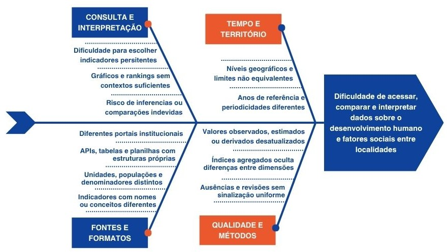

# 1. Visão Geral do Produto

## 1.1. Problema

**Contexto:** Os dados socioeconômicos brasileiros, como o Índice de Desenvolvimento Humano (IDH), são publicados por órgãos governamentais de forma descentralizada e em formatos estáticos brutos (CSV, planilhas complexas, PDF). (IBGE, [s.d.])

**Problema encontrado:** A fragmentação e a ausência de interfaces visuais dinâmicas criam uma barreira técnica, dificultando o cruzamento de dados e a análise comparativa por pesquisadores, jornalistas e gestores.

**Figura 1 — Diagrama de Ishikawa das causas do problema.**

*Fonte: Elaborado por Fabiana Reis Souza (2026).*

A Figura 1 detalha as causas-raiz desse problema. Observa-se que a dificuldade de acesso e interpretação apresenta-se em quatro frentes principais:

1. **Fontes e Formatos:** devido à dispersão em portais distintos e incompatibilidade de APIs e tabelas;
2. **Qualidade e Métodos:** lidando com dados desatualizados ou índices agregados que ocultam as dimensões reais;
3. **Tempo e Território:** onde a defasagem de anos de referências e limites geográficos prejudica o cruzamento;
4. **Consulta e Interpretação:** onde a falta de contexto induz o usuário a erros de inferência.

Para solucionar essas lacunas, a solução de software proposta é a construção de uma plataforma centralizada — dashboard — baseada em ciência de dados. A aplicação extrairá os dados brutos e os converterá em gráficos interativos e mapas, delimitados por estados, reduzindo o trabalho operacional e entregando o dado já tratado visualmente para o usuário.

## 1.2. Declaração de Posição do Produto

O Brasil Hub surge com a proposta de preencher uma lacuna técnica e de usabilidade no acesso a dados socioeconômicos do Brasil. Atualmente, as principais fontes de dados socioeconômicos do país são portais oficiais, como o IBGE e o Atlas do Desenvolvimento Humano no Brasil (PNUD, Ipea e FJP). Essas fontes são confiáveis e trazem indicadores como o IDHM, mas os dados ficam espalhados em portais distintos, com formatos próprios, o que dificulta a comparação (ATLAS DO DESENVOLVIMENTO HUMANO NO BRASIL, [s.d.]).

O diferencial do Brasil Hub é reunir os indicadores em uma única interface, com filtros por estado e por dimensão do IDH e recursos de acessibilidade, além de comparação lado a lado e exportação de dados, se houver tempo (COULD). A posição exclusiva do Brasil Hub é democratizar essa análise, entregando inteligência visual imediata. A Tabela 3 resume o posicionamento estratégico da plataforma em relação ao seu público e às alternativas competitivas.

**Tabela 3 — Declaração de posicionamento do Brasil Hub.**

| Elemento | Descrição |
|---|---|
| **Para** | Pesquisadores acadêmicos, jornalistas, gestores públicos e estudantes. |
| **Necessidade** | Superar a dificuldade técnica de encontrar dados sociais consolidados, atualizados e visualmente interpretáveis em fontes oficiais. |
| **O Brasil Hub** | É uma plataforma WEB interativa de visualização de dados (dashboard). |
| **Que** | Consolida índices sociais em gráficos, mapas de calor e rankings comparativos estaduais de forma rápida. |
| **Ao contrário** | De buscas manuais fragmentadas em portais governamentais que exigem download e tratamento prévio em planilhas. |
| **Nosso produto** | Trata e padroniza os dados e os entrega em uma interface web acessível no navegador. |

*Fonte: Elaborado por Josef Wojtyla.*

Conforme detalhado na Tabela 3, o diferencial competitivo primário da aplicação não é a geração de novos dados, mas sim a excelência na forma como eles são processados e apresentados. Ao automatizar a extração e aplicar tratamento de dados no back-end, o Brasil Hub elimina o retrabalho operacional dos pesquisadores e gestores, garantindo que o foco do usuário seja integralmente direcionado para a análise comparativa das problemáticas sociais.

## 1.3. Objetivos do Produto

**Objetivo principal:** Desenvolver um dashboard para centralizar e facilitar a visualização comparativa de fatores sociais do Brasil com enfoque nos dados estaduais.

**Objetivos específicos:**

1. Tratar e padronizar bases de dados públicas (CSV do IBGE) e disponibilizá-las por meio de uma API;
2. Implementar mapas de calor interativos com a biblioteca Leaflet;
3. Fornecer filtros dinâmicos por estado e por dimensão do IDH (renda, educação e longevidade).

O objetivo principal é atendido pelos requisitos B-01 e B-06 da Tabela 13. O objetivo específico 1 é atendido por B-04 e B-05, o 2 por B-01 e o 3 por B-02.

## 1.4. Tecnologias a Serem Utilizadas

- **Backend:** Python com Pandas para manipulação massiva e limpeza dos dados brutos e FastAPI para expor os dados tratados de forma ágil e com documentação automática.
- **Banco de dados:** SQLite por sua natureza serverless, dispensando configuração de infraestrutura complexa, garantindo integração nativa com o ecossistema Python e atendendo ao princípio de simplicidade do projeto.
- **Frontend:** JavaScript para garantir a reatividade da interface aliado ao Leaflet para renderização dos mapas geográficos.
- **Deploy e hospedagem:** Vercel e GitHub Pages (documentação).
- **Testes:** Pytest para os testes de unidade da manipulação de dados no back-end Python e Jest componentes do front-end JavaScript.
- **Documentação:** MkDocs com Material Theme hospedado no GitHub Pages conforme infraestrutura padrão da disciplina.
- **Canal de comunicação:** WhatsApp para alinhamentos rápidos diários e GitHub Projects — Kanban — para o rastreamento oficial de Issues e Sprints.
